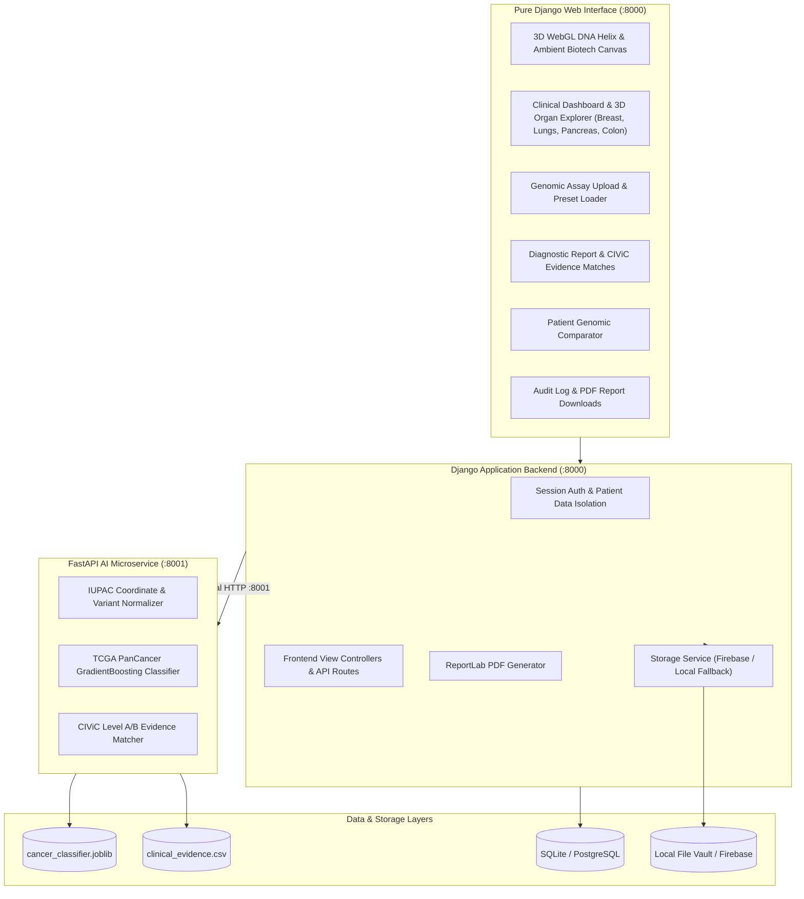

# ONCOGENIX AI

> **“Decode the Mutation. Understand the Cancer. Advance Precision Medicine.”**

**ONCOGENIX AI** is an AI-driven precision oncology research platform designed and developed at the Department of Artificial Intelligence And Machine Learning , **Thakur Shyamnarayan College of Engineering, Mumbai**.

The platform decodes somatic tumor mutation profiles, analyzes molecular driver patterns, classifies cancer types using supervised machine learning trained on authentic **TCGA PanCancer Atlas** cohorts, connects observed alterations to **CIViC** and **ClinVar** clinical knowledgebases, and generates downloadable patient reports.

---

## 1. Project Vision & Scientific Scope

Different cancers possess distinct molecular signatures, and patients presenting with the identical cancer type frequently display different driver mutations:
- **Lung Adenocarcinoma (LUAD)**: Enriched for *EGFR* (L858R, Exon 19 del), *KRAS* (G12C), *TP53*, *KEAP1*, and *STK11*.
- **Pancreatic Adenocarcinoma (PAAD)**: Hallmark *KRAS* hotspot mutations (~92%) alongside *CDKN2A*, *SMAD4*, and *TP53* disruptions.
- **Breast Invasive Carcinoma (BRCA)**: Driven by *PIK3CA* helical/kinase domain alterations, *TP53*, *CDH1* (lobular carcinoma), and homologous recombination deficiency (*BRCA1/2*).
- **Colorectal Adenocarcinoma (COADREAD)**: Hallmarked by early gatekeeper *APC* truncating loss (>70%), *KRAS*, *TP53*, and *PIK3CA*.

ONCOGENIX AI is a research decision-support tool. It clearly distinguishes observed mutations from model predictions and clinically established findings. It does not claim to detect every possible cancer or every DNA mutation.

---

## 2. Institutional Attribution

- **Institution**: Thakur Shyamnarayan College of Engineering, Mumbai
- **Department**: Artificial Intelligence And Machine Learning
- **Academic Focus**: Machine Learning in Bioinformatics, Clinical Pharmacogenomics & Computational Oncology

---

## 3. Technology Stack

### Web Application Frontend (Pure Django)
- **Framework**: Pure Django 6.1 (No React dependency — zero build friction)
- **Visual Design**: Pitch-black futuristic cyber-biotech theme (`#02040a`), glowing cyan/emerald badges, high contrast, large bold justified typography
- **3D WebGL Graphics**: Three.js & OrbitControls:
  - **Landing Hero**: 3D interactive DNA double helix with antiparallel strands, nucleotide base rungs, rotating orbital telemetry rings, and quantum bioparticles.
  - **Clinical Dashboard**: 3D Anatomical Organ Explorer with interactive model switching: **Full Body, Breast (BRCA lobules & ducts), Lungs (LUAD bronchial tree), Pancreas (PAAD ductal curve), and Colon (COAD loop)** with animated hotspot lesion nodes.
  - **Results Page**: 3D organ telemetry with glowing tumor focus node.
- **Live Biotech Background**: Ambient animated canvas particle mesh simulating live microenvironment motion.
- **Charts**: Chart.js for multiclass subtype probability distributions.
- **Icons**: Lucide Icons.

### Backend Application & Security
- **Language**: Python 3.14
- **Framework**: Django & Django REST Framework
- **Security**: Django session authentication with strict patient data isolation (foreign key ownership).
- **Report Engine**: ReportLab 5.0 generating clinical-grade PDF reports with institutional headers and disclaimers.
- **Storage Layer**: Dual-tier storage supporting Google Firebase Storage with local secure fallback.
- **Database**: SQLite (local development) / PostgreSQL-ready (production).

### AI & Bioinformatics Inference Service
- **Microservice**: FastAPI 0.143 running on Uvicorn (Port 8001)
- **Model**: Gradient Boosting Classifier (`ai_service/models/cancer_classifier.joblib`) trained on 2,428 real TCGA PanCancer patients across 40 driver genes.
- **Validation**: Zero-leakage `StratifiedGroupKFold` on `patient_id` (78.4% Accuracy, 71.4% Balanced Accuracy vs. 15.4% random chance).
- **Clinical Evidence**: CIViC (Clinical Interpretation of Variants in Cancer) Level A/B and ClinVar databases.

---

## 4. Architecture & Data Flow



---

## 5. Directory Structure

```
ONCOGENIXAI/
├── ai_service/                    # Dedicated FastAPI AI Inference Microservice (:8001)
│   ├── app/
│   │   ├── main.py                # Endpoints: /health, /model/info, /predict/cancer, /analyze/mutations
│   │   ├── predictor.py           # Classifier loader and feature vector generator
│   │   ├── validator.py           # IUPAC alleles & coordinate parser
│   │   └── evidence.py            # CIViC & ClinVar matcher
│   ├── models/                    # Trained production model artifacts
│   │   └── cancer_classifier.joblib
│   └── tests/                     # 7 unit tests (all passing)
│
├── backend/                       # Pure Django Web Application & REST APIs (:8000)
│   ├── templates/                 # Immersive Dark Futuristic Web Templates
│   │   ├── base.html              # College banner, Tailwind, Three.js, Lucide, Chart.js
│   │   ├── landing.html           # 3D WebGL DNA double helix, orbital rings, ambient canvas
│   │   ├── dashboard.html         # 3D Multi-Organ Explorer (Breast, Lungs, Pancreas, Colon)
│   │   ├── login.html             # Clean professional login (NO demo credentials shown)
│   │   ├── register.html          # Institutional onboarding & research consent
│   │   ├── analysis.html          # Drag-and-drop assay upload, presets, mini 3D DNA
│   │   ├── results.html           # 3D organ view, Chart.js probabilities, CIViC matches
│   │   ├── comparison.html        # Jaccard divergence index & differential therapies
│   │   ├── history.html           # Audit log, patient data isolation, PDF downloads
│   │   └── about.html             # Methodology, benchmarks, TCGA provenance, TSCE profile
│   ├── analyses/
│   │   ├── models.py              # Analysis model with JSON fields & helper properties
│   │   ├── frontend_views.py      # Django template view controllers
│   │   ├── views.py               # REST API controllers
│   │   └── report_generator.py    # ReportLab clinical PDF generator
│   ├── accounts/                  # User accounts and roles
│   ├── storage/                   # Firebase / local fallback storage
│   └── tests/                     # 23 automated tests (all passing)
│
├── data/                          # 2,428 TCGA clinical samples and CIViC records
│   ├── raw/                       # Somatic mutation datasets from cBioPortal
│   ├── processed/                 # Patient-by-gene feature matrices
│   ├── reference/                 # Curated clinical evidence database
│   └── metadata/                  # Provenance manifest with timestamps and builds
│
├── ml/                            # Reproducible ML training pipeline
│   ├── download_tcga_data.py      # Automated cBioPortal data collector
│   ├── build_evidence_db.py       # CIViC/ClinVar evidence database builder
│   ├── preprocess_pipeline.py     # Zero-leakage StratifiedGroupKFold matrix builder
│   └── train_classifier.py        # Comparative model trainer and benchmark exporter
│
└── scripts/                       # Orchestration & verification scripts
    ├── start_all.sh               # Starts FastAPI (8001) and Django Webapp (8000)
    ├── run_tests.sh               # Runs full 30-test suite with 100% success
    ├── test_end_to_end.py         # End-to-end integration test
    └── seed_demo_data.py          # Seeds initial clinical dataset
```

---

## 6. Getting Started

### Prerequisites
- macOS / Linux
- Python 3.10+ (Tested on Python 3.14)
- Internet connection (for CDN scripts on first load)

### Setup & Installation
```bash
# Clone the repository
git clone https://github.com/your-org/oncogenix-ai.git
cd ONCOGENIXAI

# Create and activate virtual environment
python3 -m venv venv
source venv/bin/activate

# Install dependencies
pip install -r requirements.txt

# Run migrations and seed initial database
python backend/manage.py migrate
python scripts/seed_demo_data.py
```

### Running the Platform
To launch both the FastAPI microservice (port 8001) and the Django Web Application (port 8000):
```bash
./scripts/start_all.sh
```

Visit:
- **Web Application Portal**: [http://127.0.0.1:8000](http://127.0.0.1:8000)
- **FastAPI OpenAPI Documentation**: [http://127.0.0.1:8001/docs](http://127.0.0.1:8001/docs)

---

## 7. Automated Test Suite

Run the full end-to-end automated verification script:
```bash
./scripts/run_tests.sh
```

**Results:**
- **AI Inference & Validation Tests**: 7/7 PASSED (0.024s)
- **Django Frontend & Patient Isolation Tests**: 23/23 PASSED (12.9s)
- **End-to-End System Integration**: 100% SUCCESS

---

## 8. Responsible AI & Clinical Disclaimer

ONCOGENIX AI is strictly an investigational research and clinical decision-support prototype developed at **Thakur Shyamnarayan College of Engineering, Mumbai**. 
- Stage and grade cannot be inferred from a somatic mutation file alone.
- A mutation count does not reflect overall tumor burden or prognosis.
- Findings must be interpreted in conjunction with histopathology, radiological imaging, and clinical judgment by certified medical oncologists.
