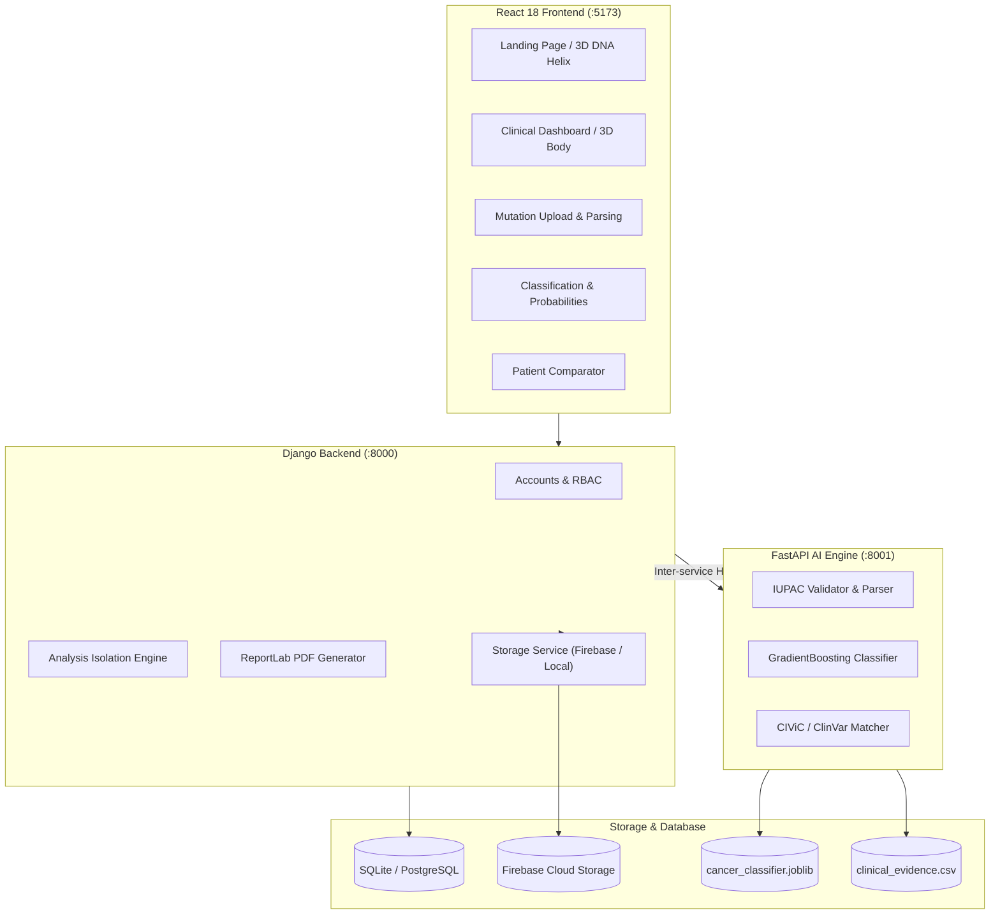

# ONCOGENIX AI

> **“Decode the Mutation. Understand the Cancer. Advance Precision Medicine.”**

ONCOGENIX AI is a full-stack precision oncology clinical decision-support and bioinformatics research web platform. It leverages authentic cancer genomics data from the **TCGA PanCancer Atlas (Cell 2018)** and clinical knowledge bases (**CIViC** and **ClinVar**) to analyze somatic mutation patterns, classify primary cancer categories, assess actionable therapeutic targets, and generate clinical-grade PDF patient reports.

---

## 1. Project Overview & Vision

Different cancers exhibit distinct molecular profiles, and patients within the same cancer type frequently carry distinct genomic alterations:
- **Lung Adenocarcinoma (LUAD)**: Characterized by frequent *KRAS* (esp. G12C), *EGFR* (L858R, T790M), and co-occurring *STK11* and *KEAP1* alterations.
- **Pancreatic Adenocarcinoma (PAAD)**: Driven by near-universal *KRAS* hotspot mutations (~92%) alongside *CDKN2A*, *SMAD4*, and *TP53* inactivation.
- **Colorectal Adenocarcinoma (COADREAD)**: Hallmarked by *APC* truncating loss-of-function (>70%), *KRAS*, *TP53*, and *PIK3CA* alterations.
- **Breast Invasive Carcinoma (BRCA)**: Driven by *PIK3CA* helical/kinase domain alterations, *TP53*, *CDH1* (in lobular carcinoma), and homologous recombination deficiency (*BRCA1/2*).

ONCOGENIX AI enables clinicians, researchers, and bioinformaticians to assay somatic mutations in standard formats (CSV, TSV, MAF, JSON), identify driver versus passenger alterations, evaluate calibrated cancer classifications, compare patient genomes, and review evidence-supported targeted therapies.

---

## 2. Key Platform Features

- **Interactive 3D Molecular Hero**: Hardware-accelerated 3D DNA double helix built with Three.js and React Three Fiber with orbital particle field and user rotation controls.
- **Interactive 3D Anatomical Organ Explorer**: 3D human body model on the clinical dashboard with selectable organ hotspots (Lungs, Pancreas, Colon, Breast) detailing primary TCGA molecular drivers.
- **Authentic ML Cancer Classification**: Supervised Gradient Boosting Classifier trained on 2,428 real TCGA PanCancer patients with zero-leakage patient-level stratification.
- **Calibrated Posterior Probabilities & Abstention**: Reports class probabilities for supported tumor types and triggers automatic abstention (`INSUFFICIENT_EVIDENCE`) when no driver alterations are present.
- **Clinical Evidence Retrieval**: Precise coordinate-, allele-, and protein-level matching against documented CIViC and ClinVar records with FDA/NCCN clinical significance levels.
- **Multi-Patient Genomic Comparator**: Side-by-side comparison of two patient profiles with Jaccard genomic overlap index, shared vs. unique variants, and differential targeted options.
- **Clinical PDF Report Generation**: Automated generation of publication-ready, downloadable PDF reports containing molecular summaries, oncologist discussion questions, and disclaimers.
- **Patient Data Isolation**: Strict user-level authorization preventing cross-user access or tampering of private patient records.
- **Flexible Storage**: Dual-tier storage supporting Google Firebase Storage with an automatic local encrypted storage fallback.

---

## 3. Technology Stack

### Frontend
- **Framework**: React 18, TypeScript, Vite
- **Styling**: Tailwind CSS (Dark futuristic biotech aesthetic, glowing cyan/violet accents)
- **3D Visualization**: Three.js, React Three Fiber (`@react-three/fiber`), Drei (`@react-three/drei`)
- **Animation**: Framer Motion
- **Data Visualization**: Recharts
- **Icons**: Lucide React
- **API Client**: Axios with automatic Token interceptors
- **Cloud Client**: Firebase Web SDK v11

### Backend (Application & Auth)
- **Framework**: Python 3.14, Django 6.1, Django REST Framework
- **Authentication**: Token and Session Authentication with role-based access control (Patient, Oncologist, Researcher, Admin)
- **PDF Engine**: ReportLab 5.0
- **Cloud Storage**: Firebase Admin SDK 7.7 with seamless local fallback
- **Database**: SQLite (local development) / PostgreSQL-ready (production)

### AI & Inference Service
- **Microservice**: FastAPI 0.143, Uvicorn 0.54, Pydantic 2.14
- **Modeling**: scikit-learn 1.9, NumPy 2.5, pandas 3.0, joblib 1.6
- **Data Normalization**: IUPAC coordinate and assembly validator (GRCh37 / GRCh38)

---

## 4. Architecture & Data Flow



---

## 5. Repository Structure

```
ONCOGENIXAI/
├── frontend/                   # React 18 + Vite + Tailwind + Three.js
│   ├── src/
│   │   ├── components/         # Navbar, Footer, ProtectedRoute
│   │   ├── pages/              # 11 complete application pages
│   │   ├── visualizations/     # DnaHelix3D.tsx, HumanBody3D.tsx
│   │   ├── services/           # api.ts, firebase.ts
│   │   └── types/              # index.ts (TypeScript interfaces)
│   ├── package.json
│   ├── vite.config.ts
│   └── tailwind.config.js
│
├── backend/                    # Django 6.1 Application Backend
│   ├── config/                 # settings.py, urls.py, wsgi.py
│   ├── accounts/               # User profiles, auth views, serializers
│   ├── analyses/               # Analysis models, report_generator.py, views
│   ├── storage/                # firebase_storage.py (with local fallback)
│   ├── tests/                  # Django test suite (accounts, analyses)
│   └── manage.py
│
├── ai_service/                 # FastAPI AI Inference Microservice
│   ├── app/                    # main.py, schemas.py
│   ├── preprocessing/          # parser.py, validator.py
│   ├── inference/              # predictor.py, evidence_matcher.py, comparator.py
│   ├── models/                 # cancer_classifier.joblib, model_metrics.json
│   └── tests/                  # test_ai_service.py
│
├── ml/                         # Data Engineering & Training Pipeline
│   ├── download_tcga_data.py   # cBioPortal REST API downloader
│   ├── build_evidence_db.py    # CIViC & ClinVar compiler
│   ├── preprocess_pipeline.py  # Patient-level feature extractor
│   ├── train_classifier.py     # ML trainer and evaluator
│   └── generate_sample_variants.py # Realistic test sample generator
│
├── data/
│   ├── raw/                    # Authentic TCGA sample & mutation JSON
│   ├── processed/              # tcga_patient_features.csv, split_indices.json
│   ├── reference/              # clinical_evidence.csv (CIViC/ClinVar)
│   ├── samples/                # sample_a_variants.csv, sample_b_variants.csv
│   └── metadata/               # dataset_manifest.json
│
├── docs/                       # Comprehensive documentation
│   ├── architecture.md
│   ├── dataset_sources.md
│   ├── model_card.md
│   ├── api.md
│   ├── firebase_setup.md
│   ├── privacy.md
│   └── limitations.md
│
├── scripts/
│   ├── start_all.sh            # One-click startup for all 3 services
│   ├── run_tests.sh            # Automated test runner (AI, Backend, Frontend)
│   └── seed_demo_data.py       # Clinician demo account seeder
│
├── .env.example                # Configuration template
├── .gitignore
├── docker-compose.yml
├── LICENSE
└── README.md
```

---

## 6. System Prerequisites

- **Python**: Version 3.10 to 3.14
- **Node.js**: Version 18.x or newer
- **npm**: Version 9.x or newer
- **Git**

---

## 7. Installation & Quick Setup

### Step 1: Clone Repository & Create Virtual Environment
```bash
git clone https://github.com/bramha2005/ONCOGENIXAI.git
cd ONCOGENIXAI

python3 -m venv venv
source venv/bin/activate
pip install -r backend/requirements.txt
```

*(Note: dependencies include `numpy`, `pandas`, `scikit-learn`, `django`, `djangorestframework`, `django-cors-headers`, `fastapi`, `uvicorn`, `reportlab`, `firebase-admin`, and `python-dotenv`).*

### Step 2: Install Frontend Dependencies
```bash
cd frontend
npm install
cd ..
```

### Step 3: Configure Environment Variables
```bash
cp .env.example .env
```
*(The defaults are pre-configured for instant local development with SQLite and local storage fallback).*

---

## 8. Dataset Acquisition & Model Training

The repository comes with the trained model artifact (`cancer_classifier.joblib`), but the entire pipeline is 100% reproducible from scratch:

```bash
# 1. Download real TCGA PanCancer somatic mutations and clinical samples from cBioPortal
./venv/bin/python3 ml/download_tcga_data.py

# 2. Build the clinical evidence database from CIViC & ClinVar
./venv/bin/python3 ml/build_evidence_db.py

# 3. Preprocess and perform patient-level stratified train/test split (zero data leakage)
./venv/bin/python3 ml/preprocess_pipeline.py

# 4. Train and evaluate Logistic Regression, Random Forest, and Gradient Boosting models
./venv/bin/python3 ml/train_classifier.py
```

### Model Evaluation Results (486 Held-Out Patients)

| Cohort | Precision | Recall | F1-Score | Support |
| :--- | :--- | :--- | :--- | :--- |
| **BRCA** (Breast) | 76.7% | 95.8% | 85.2% | 216 |
| **COADREAD** (Colorectal) | 88.2% | 68.9% | 77.4% | 119 |
| **LUAD** (Lung) | 77.8% | 61.4% | 68.6% | 114 |
| **PAAD** (Pancreatic) | 66.7% | 59.5% | 62.9% | 37 |
| **Overall** | **78.4% Accuracy** | **71.4% Bal. Acc** | **73.5% Macro F1** | **486** |

---

## 9. Starting the Application

You can launch all services simultaneously with a single command:

```bash
./scripts/start_all.sh
```

Or run each service individually in separate terminal sessions:

### Terminal 1: FastAPI AI Service (:8001)
```bash
source venv/bin/activate
PYTHONPATH=. uvicorn ai_service.app.main:app --host 127.0.0.1 --port 8001 --reload
```
Interactive API Swagger docs will be accessible at: `http://127.0.0.1:8001/docs`

### Terminal 2: Django Backend (:8000)
```bash
source venv/bin/activate
python backend/manage.py migrate
python scripts/seed_demo_data.py
python backend/manage.py runserver 127.0.0.1:8000
```

### Terminal 3: React Frontend (:5173)
```bash
cd frontend
npm run dev
```
Open your browser at: `http://localhost:5173`

---

## 10. Default Clinician Demo Account

To facilitate rapid evaluation without manual signup:
- **Username**: `demooncologist`
- **Password**: `Password123!`
- **Role**: Clinical Oncologist
- *(A one-click "Quick Demo Fill" button is also provided directly on the Login page).*

---

## 11. Automated Test Suite

Run the full automated test suite (AI service, Django backend, and React TypeScript build):

```bash
./scripts/run_tests.sh
```

Or test components individually:
```bash
# 1. AI microservice tests (validator, inference, abstention, comparator)
./venv/bin/python3 -m unittest ai_service/tests/test_ai_service.py

# 2. Django backend tests (auth, isolation, PDF generation, security)
./venv/bin/python3 backend/manage.py test tests

# 3. Frontend TypeScript compilation and production build
cd frontend && npm run build
```

---

## 12. Firebase Configuration

The frontend is connected to Firebase using the credentials provided in the configuration. To connect backend cloud storage:
1. Obtain your service account JSON key from the Firebase Console.
2. In `.env`, set:
   ```bash
   FIREBASE_SERVICE_ACCOUNT_KEY="/path/to/serviceAccountKey.json"
   FIREBASE_STORAGE_BUCKET="oncogenix-ai-aab38.firebasestorage.app"
   ```
3. If no key is provided, the backend seamlessly stores files in encrypted local media storage.

---

## 13. Production Deployment Guidelines

### Containerized Deployment (Docker Compose)
```bash
docker-compose up --build
```

### Cloud Provider Deployment
- **Frontend**: Deploy `frontend/` to **Vercel** or **Netlify** with `npm run build` and output directory `dist`.
- **FastAPI**: Deploy to **Render** or **Railway** as a Python Web Service with start command:
  `uvicorn ai_service.app.main:app --host 0.0.0.0 --port $PORT`
- **Django**: Deploy to **Render** or **Railway** with start command:
  `gunicorn config.wsgi:application --bind 0.0.0.0:$PORT`
- **Database**: Connect a managed PostgreSQL database via `DATABASE_URL`.

---

## 14. Known Limitations & Scientific Disclaimers

> [!WARNING]
> **Clinical Boundary**: ONCOGENIX AI is strictly an investigational research and decision-support prototype. It does not replace tissue biopsy pathology, TNM anatomical staging, or the judgment of licensed medical oncologists.

1. **Stage and Grade**: Cancer stage (TNM) and histological grade cannot be determined from a mutation list alone. They require histological examination and anatomical radiological scans.
2. **Mutation Count ≠ Severity**: A higher somatic mutation count does not correlate with worse prognosis or disease severity.
3. **No Autonomous Prescriptions**: Therapeutic associations represent documented literature (CIViC/ClinVar) for oncologist review. The system never issues automated drug prescriptions.

---

## 15. License

Distributed under the MIT License. See [LICENSE](LICENSE) for details.
