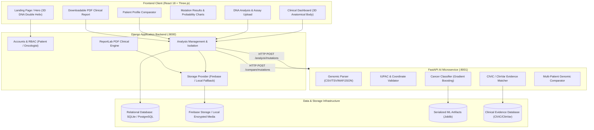

# ONCOGENIX AI — Architecture & System Design

## 1. System Overview

ONCOGENIX AI is a precision oncology clinical decision-support and research web application. It combines DNA mutation parsing, supervised machine learning for cancer classification, and automated matching against documented clinical evidence databases (CIViC and ClinVar).

The system adopts a microservice architecture:
- **Frontend**: React 18, TypeScript, Vite, Tailwind CSS, Three.js / React Three Fiber, Recharts, Framer Motion.
- **Application Backend**: Django 6.1 + Django REST Framework handling authentication, user profiles, analysis history, PDF report generation, and data access control.
- **AI Inference Microservice**: FastAPI + Uvicorn serving the trained precision oncology models, IUPAC genomic validators, and CIViC evidence matching engine.
- **Storage Tier**: Hybrid Firebase Storage with automated secure local fallback for genomic files and clinical reports.
- **Database**: Relational SQLite for local development and PostgreSQL-ready configuration for production deployments.

---

## 2. Architecture Diagram

---

## 3. Communication Protocols

| Route / Channel | Source | Destination | Protocol | Purpose |
| :--- | :--- | :--- | :--- | :--- |
| `/api/auth/*` | React | Django | REST / Token | Authentication, sign up, session management |
| `/api/analyses/*` | React | Django | REST / Multipart | File upload, report downloads, history CRUD |
| `/analyze/mutations` | Django | FastAPI | HTTP JSON / Inter-service | Genomic parsing, validation, ML classification |
| `/compare/mutations` | Django | FastAPI | HTTP JSON / Inter-service | Two-patient genomic and therapeutic diff |
| `/model/info` | Django / React | FastAPI | HTTP JSON | Model metrics, feature importances, status |
| Storage Bucket | Django / StorageAdapter | Firebase Storage | HTTPS Admin SDK | Secure persistent object storage |

---

## 4. Security & Patient Data Isolation

1. **Patient Data Isolation**: Every `Analysis` record is strictly bound to its creating `User` instance in Django via foreign keys. Requests to view, delete, or download reports check ownership, returning `404 Not Found` if a user attempts to access another patient's data.
2. **De-identification**: Patient identifiers are treated as pseudonymous barcodes (`SAMPLE-LUAD-001`, `PT-8294`). Identifiers are never used as model features.
3. **No Hardcoded Secrets**: Firebase configuration, Django secret keys, and database passwords are read from environment variables (`.env`).
